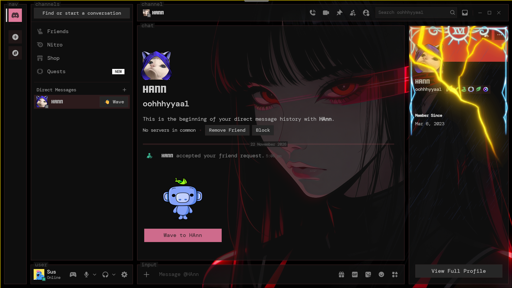
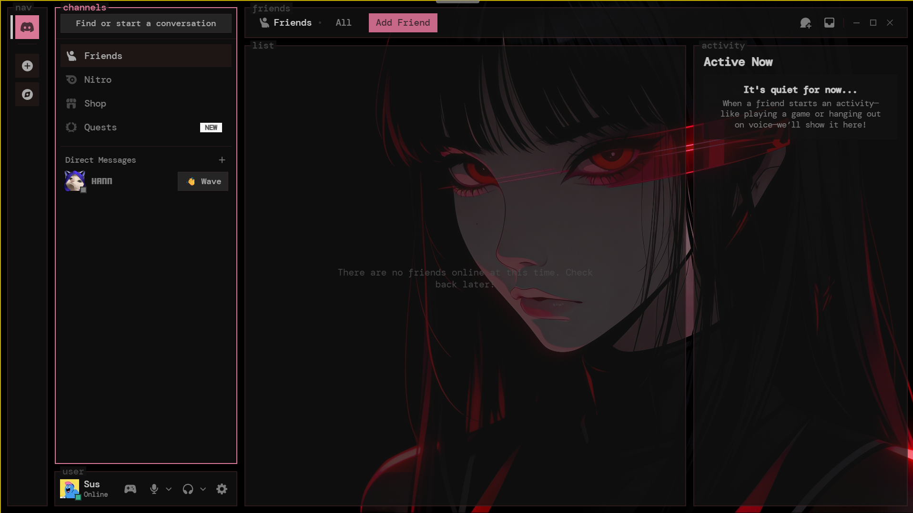

# System32 Anime

A dark anime-inspired theme for [Vencord](https://vencord.dev/) and [Equicord](https://github.com/Equicord/Equicord), based on [System24](https://github.com/refact0r/system24).

## Previews

### Profile and direct message

### Friends view

## Features

- Dark charcoal surfaces with muted red accents
- Anime background image with gentle motion
- Subtle hover effects for the Friends list and Add Friend button
- Reduced-motion support
- DM Mono typography
- Custom System32 ASCII loading screen

## Installation

1. Download [`system32-vencord.theme.css`](system32-vencord.theme.css).
2. Put it in your Vencord or Equicord themes folder.
3. In Discord, open **User Settings → Themes** and enable **System32 Anime**.

The theme imports the base System24 stylesheet from the web, so that stylesheet must remain reachable for the theme to load fully. The background image is also loaded from an external URL.

### Optional background URL plugin

The [Background Image URL plugin](./plugins/backgroundImageUrl/README.md) changes backgrounds for themes that use a CSS custom property. It is not limited to System32 Anime. It is a custom Vencord-style user plugin and requires a source-built client; see its README for setup details.

## Credits

- Base theme: [System24 by refact0r](https://github.com/refact0r/system24)
- Supported clients: [Vencord](https://vencord.dev/) and [Equicord](https://github.com/Equicord/Equicord)
- Theme customization: Rayyan

## License

No license has been specified yet. Ask the author before reusing or redistributing this customization.
